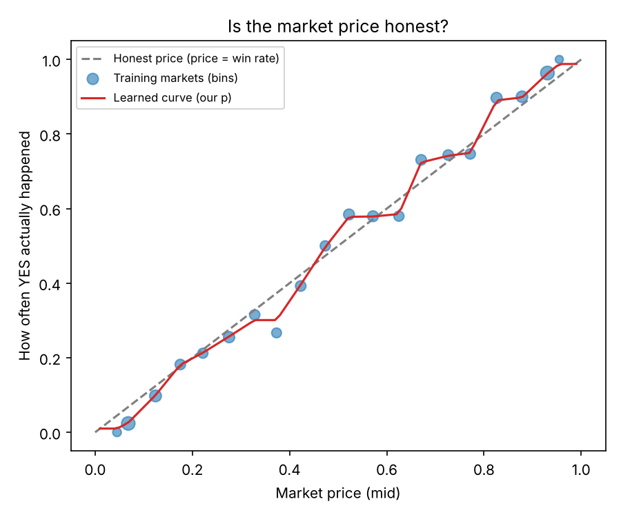
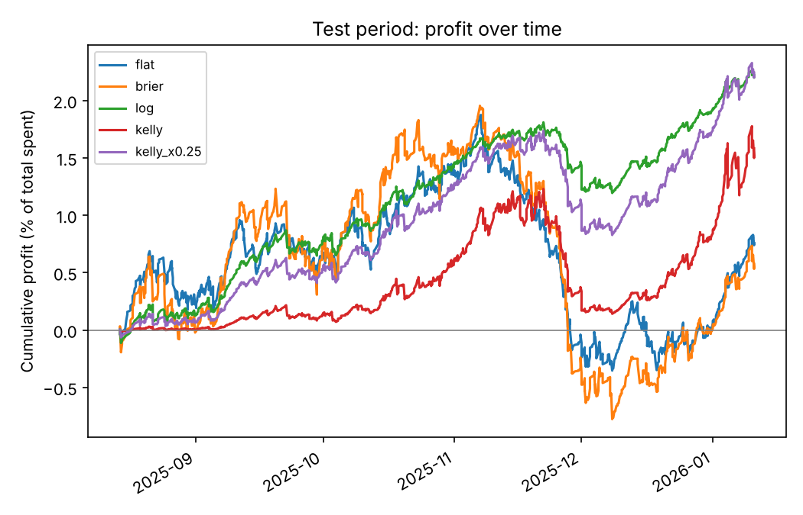

# Kalshi Proper Betting Backtester

Test a research-backed betting strategy on past Kalshi prediction markets.

This project puts two 2026 research papers together:

1. **Bürgi, Deng & Whelan, "Makers and Takers: The Economics of the Kalshi Prediction Market"** (CEPR DP 20631). It shows that Kalshi prices have a *favorite–longshot bias*: cheap contracts win less often than their price says.
2. **Gu, Kagan, Sun, Wu & Xu, "When do prophets profit in prediction markets?"** ([arXiv:2607.06166](https://arxiv.org/abs/2607.06166)). It proves a "proper betting" rule that turns a better-than-market forecast into profit, and shows that Kelly betting does not.

Paper 1 gives us a **probability** that can beat the market price. Paper 2 tells us **how much to bet** on it. This code tests both on real Kalshi data.

> ⚠️ This is a learning and research project, not financial advice. Past results do not predict future results.

---

## The idea, step by step

**Step 1. A price is a probability.**
A YES contract pays $1 if the event happens. So if a contract costs 30¢ and the event happens 30% of the time, the buyer breaks even. That is why people read a 30¢ price as "a 30% chance."

**Step 2. We can check if prices are honest.**
Because of Step 1, contracts priced at 10¢ should win 10% of the time. So we can group many past markets by price and count how often YES really happened. This is a *calibration curve*.

**Step 3. Kalshi prices are a little off at the ends.**
Paper 1 found that cheap contracts win *less* than their price says and expensive ones win a bit *more*. Because this pattern is steady over time, a calibration curve learned on **old** markets gives us a better probability `p` for **new** markets.

**Step 4. Only bet when your edge beats the price you actually pay.**
Buying YES at the ask price `a` makes money on average only if `p > a`. Buying NO at price `b` makes money only if `p < 1 − b`. Between those two numbers is a "do nothing" zone where the spread eats your edge.

**Step 5. Size the bet with the proper betting rule.**
Paper 2 proves that the safe way to size a bet is:

| Rule | Contracts to buy are proportional to |
|---|---|
| Brier | `p − reference price` |
| Log | `logit(p) − logit(reference price)` |

The reference price is the price you really pay (the YES ask, or 1 − the NO ask). Because the size grows with your edge, you bet more where you disagree more with the market.

**Step 6. Compare against simple rules.**
The backtest also runs a **flat** rule (same bet every time) and **Kelly** (full and quarter). Kelly assumes your `p` is exactly right. Because real forecasts are never exactly right, Kelly bets too big and can wipe out your money.

---

## Files

| File | What it does |
|---|---|
| `kalshi_data.py` | Downloads settled markets and their prices from Kalshi's free public API |
| `forecasters.py` | Learns the calibration curve (your `p`) from past markets |
| `strategies.py` | The betting rules (flat, Brier, log, Kelly) and Kalshi's taker fee |
| `backtest.py` | Splits data by time, runs every rule, prints results, saves charts |
| `make_fake_data.py` | Makes fake data with a known bias, to test the code without internet |
| `tests/test_core.py` | Automatic checks (run with `python -m pytest -q`) |

---

## Setup

You need Python 3.10 or newer.

```bash
git clone https://github.com/<your-username>/kalshi-proper-betting.git
cd kalshi-proper-betting
pip install -r requirements.txt
python -m pytest -q        # should say "10 passed"
```

## Run it

### 1. Try it on fake data first (no internet needed)

```bash
python make_fake_data.py
python backtest.py --data data/fake_markets.csv
```

Because we built the bias into the fake data, the backtest should find a small positive edge. That proves the code works before we trust it on real data.

### 2. Download real Kalshi data

Find a **series ticker** on kalshi.com. Open any market and look at the ticker in the URL or the market details. A series is a family of repeating markets, like a daily weather market. Series with many markets work best.

```bash
python kalshi_data.py --series KXHIGHNY --hours-before 24
```

This saves `data/KXHIGHNY.csv`. `--hours-before 24` means "pretend we bet 24 hours before the market closed." Add `--max-markets 50` for a quick test.

### 3. Backtest on real data

```bash
python backtest.py --data data/KXHIGHNY.csv
python backtest.py --data data/KXHIGHNY.csv --min-edge 0.02   # only bet with 2+ points of edge
```

### 4. Use your own forecasts (optional)

Add a column called `p_forecast` to the CSV (for example, probabilities from your own model or an AI model), then run:

```bash
python backtest.py --data data/KXHIGHNY.csv --use-csv-forecast
```

### Options

| Option | Meaning |
|---|---|
| `--budget 1000` | Dollars to spend over the test period |
| `--train-frac 0.6` | First 60% of events are for learning, last 40% for testing |
| `--min-edge 0.02` | Skip bets with less than 2 points of edge |
| `--no-fees` | Turn off Kalshi's taker fee |
| `--fee-rate 0.07` | Change the fee rate if Kalshi changes it |
| `--out results` | Folder for the output files |

---

## Reading the results

The backtest prints a table and saves `results/summary.csv`, `results/trades.csv`, and two charts.

| Column | Meaning |
|---|---|
| `bets` | How many markets the rule bet on |
| `spent` | Money spent, including fees |
| `roi_%` | Profit ÷ money spent |
| `roi_95%_low` / `roi_95%_high` | The range ROI could reasonably be in. If the range includes 0, the result could just be luck |
| `end_money` | Your budget plus profit |

Why the 95% range resamples **events**, not single markets: markets in the same event move together. For example, if one temperature bucket wins, its neighbors lose. Treating them as separate coin flips would make the results look more certain than they are.

For Kelly, `spent` is much larger than the budget because Kelly re-bets its winnings over and over.

### Example on fake data




What the three fake-data tests showed:

| Fake world | What happened | What it teaches |
|---|---|---|
| Market has the longshot bias | Log rule: +2.2% ROI, range above 0 | The calibration curve finds a real bias |
| Honest market (no bias) | Every rule loses about the spread + fees | The code does not invent an edge that isn't there |
| Forecaster slightly *worse* than market | Full Kelly: $1,000 → $0.01. Log rule: about break-even | Accuracy comes first, and Kelly is dangerous |

---

## Honest limits

- **Fill prices are estimates.** We use the bid and ask at the end of an hourly candle. Real trades can get worse prices, and we ignore order-book depth.
- **We assume you are a taker.** Paper 1 says makers (limit orders) do better, but a backtest cannot know whether a limit order would have filled.
- **Kelly is simplified.** It assumes each market settles before the next bet.
- **Fees change.** The default is Kalshi's general taker fee, 0.07 × contracts × P × (1 − P), rounded up to the cent. Some series use different rates.
- **The bias may shrink.** Paper 1 found it weaker in 2025 than in 2024. Test on recent data.

## Data sources

- Kalshi API, free and no key needed for market data: <https://docs.kalshi.com/getting_started/historical_data>
- Bigger option: Jonathan Becker's public Kalshi + Polymarket dataset (~36 GB): <https://github.com/jon-becker/prediction-market-analysis>

## References

- Bürgi, C., Deng, W., & Whelan, K. (2026). *Makers and Takers: The Economics of the Kalshi Prediction Market.* CEPR Discussion Paper 20631.
- Gu, A., Kagan, N., Sun, A., Wu, J., & Xu, H. (2026). *When do prophets profit in prediction markets?* arXiv:2607.06166.
- Becker, J. (2026). *The Microstructure of Wealth Transfer in Prediction Markets.* SSRN 7217640.

## License

MIT
